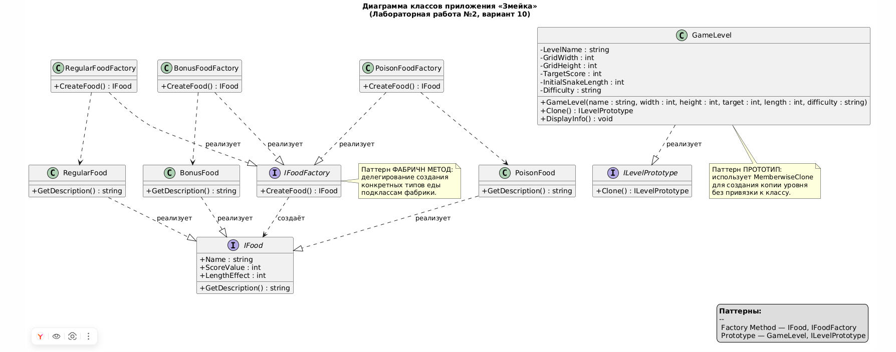
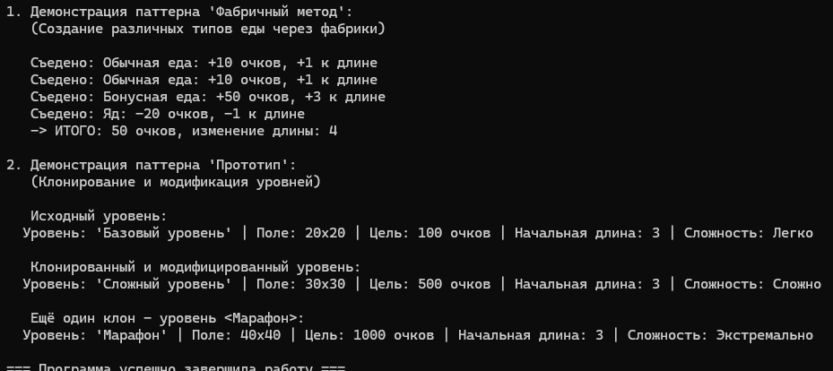

# Министерство науки и высшего образования Российской Федерации

**Федеральное государственное автономное образовательное учреждение высшего образования**  
«СЕВЕРО-КАВКАЗСКИЙ ФЕДЕРАЛЬНЫЙ УНИВЕРСИТЕТ»

**Институт информационных технологий и кибербезопасности**  
**Межинститутская базовая кафедра**

**Дисциплина:** Паттерны проектирования

## ОТЧЕТ ПО ЛАБОРАТОРНОЙ РАБОТЕ №2

**Тема:** Порождающие паттерны: Абстрактная фабрика, Фабричный метод, Прототип

| | |
| :--- | :--- |
| **Выполнил:** | Смакуев Ренат Арсеньевич 4 курс, группа ПИЖ-б-о-23-2(2) 09.03.04 «Программная инженерия», очная форма обучения _____________________________ (подпись) |
| **Проверил:** | ассистент МБК ИИТиКБ Белик А. И. _____________________________ (подпись) |

**Отчет защищен с оценкой:** ___________  
**Дата защиты:** __________________

**Ставрополь, 2026 г.**

---

### Цель работы
Получить практические навыки применения порождающих паттернов проектирования для создания семейств объектов и клонирования сложных структур на языке программирования высокого уровня.

## 1. Теоретическое обоснование

В данной работе применены два порождающих паттерна:
Фабричный метод (Factory Method) – определяет интерфейс для создания объекта, но оставляет подклассам решение о том, какой класс инстанцировать. В игре «Змейка» этот паттерн используется для создания объектов разных типов еды (RegularFood, BonusFood, PoisonFood). Каждый тип еды имеет свои характеристики (очки, влияние на длину змейки), и фабрика инкапсулирует логику их создания, избавляя клиентский код от прямых вызовов конструкторов.
Прототип (Prototype) – позволяет копировать существующие объекты без привязки к их конкретным классам. В приложении этот паттерн реализован для клонирования объектов GameLevel (конфигураций уровней). Это позволяет быстро создать новый уровень (например, «Сложный») на основе существующего («Базовый»), изменив лишь несколько параметров, вместо настройки всех полей с нуля.

## 2. Проектирование и реализация

**Вариант 10:** Разработка приложения «Игра «Змейка»».

**Постановка задачи:**  Расширить функционал игры для поддержки различных типов еды/бонусов и управления конфигурациями уровней, с обязательным использованием паттернов «Фабричный метод» и «Прототип» в соответствии с методическими указаниями к лабораторной работе № 2.

### 2.1. Диаграмма классов (UML)

Реализация паттернов подтверждается следующей диаграммой классов в нотации UML:

> *Рисунок 1 – Диаграмма классов*
> 

### 2.2. Исходный код

Полный исходный код также доступен в репозитории GitHub: [https://github.com/Renat-Smak/patternLabs.git](https://github.com/Renat-Smak/patternLabs.git)

> *Рисунок 2 – Результат работы программы*
> 

## Вывод

В ходе выполнения лабораторной работы № 2 была успешно расширена функциональность игры «Змейка» (Вариант 10) на языке C# с применением двух порождающих паттернов проектирования:
Фабричный метод (Factory Method) позволил инкапсулировать логику создания различных типов еды (RegularFood, BonusFood, PoisonFood). Это сделало код гибким: добавление нового типа еды (например, GoldenFood или SpeedBoostFood) потребует лишь создания нового класса продукта и новой фабрики, без изменения клиентского кода (соблюдение принципа Open/Closed).
Прототип (Prototype) с использованием метода MemberwiseClone() обеспечил эффективное клонирование сложных объектов конфигурации уровней (GameLevel). Это избавило от необходимости писать громоздкие конструкторы с множеством параметров для создания вариаций базовых уровней. На основе одного «Базового уровня» были быстро созданы «Сложный уровень» и «Марафон» с изменением лишь нескольких параметров.