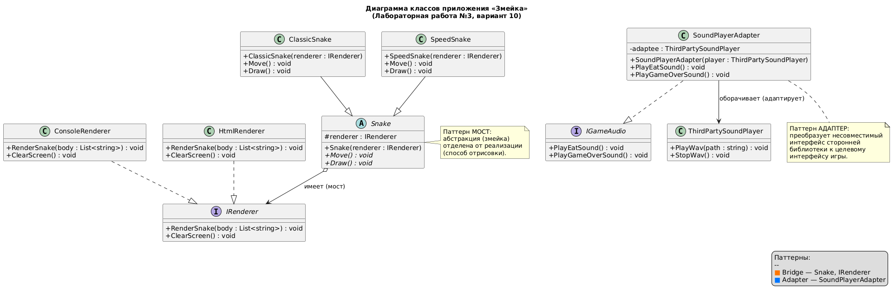
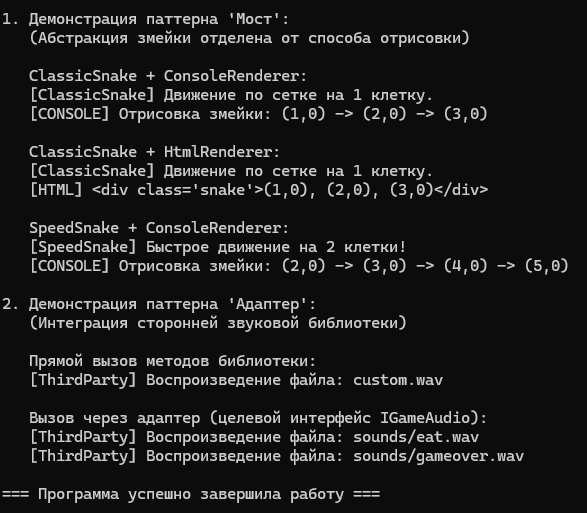

# Министерство науки и высшего образования Российской Федерации

**Федеральное государственное автономное образовательное учреждение высшего образования**  
«СЕВЕРО-КАВКАЗСКИЙ ФЕДЕРАЛЬНЫЙ УНИВЕРСИТЕТ»

**Институт информационных технологий и кибербезопасности**  
**Межинститутская базовая кафедра**

**Дисциплина:** Паттерны проектирования

## ОТЧЕТ ПО ЛАБОРАТОРНОЙ РАБОТЕ №3

**Тема:** Структурные паттерны: адаптер, мост

| | |
| :--- | :--- |
| **Выполнил:** | Смакуев Ренат Арсеньевич 4 курс, группа ПИЖ-б-о-23-2(2) 09.03.04 «Программная инженерия», очная форма обучения _____________________________ (подпись) |
| **Проверил:** | ассистент МБК ИИТиКБ Белик А. И. _____________________________ (подпись) |

**Отчет защищен с оценкой:** ___________  
**Дата защиты:** __________________

**Ставрополь, 2026 г.**

---

### Цель работы
Получить практические навыки применения структурных паттернов проектирования для организации гибких и расширяемых классовых структур на языке программирования высокого уровня.

## 1. Теоретическое обоснование

В данной работе применены два структурных паттерна:
Мост (Bridge) – разделяет один большой класс или набор тесно связанных классов на две отдельные иерархии: «абстракцию» и «реализацию», которые можно изменять независимо. В игре «Змейка» этот паттерн используется для разделения логики змейки (абстракция — Snake) от способа её отрисовки (реализация — IRenderer). Это позволяет добавлять новые типы змеек (обычная, скоростная, босс) и новые способы отрисовки (консоль, HTML, графика) независимо друг от друга, избегая взрывного числа подклассов.
Адаптер (Adapter) – позволяет объектам с несовместимыми интерфейсами работать вместе. В приложении этот паттерн реализован для интеграции сторонней звуковой библиотеки ThirdPartySoundPlayer, которая имеет методы PlayWav(string) и StopWav(), с внутренним интерфейсом игры IGameAudio, требующим методы PlayEatSound() и PlayGameOverSound(). Класс-адаптер SoundPlayerAdapter преобразует вызовы одного интерфейса в вызовы другого.

## 2. Проектирование и реализация

**Вариант 10:** Разработка приложения «Игра «Змейка»».

**Постановка задачи:**  Расширить функционал игры для поддержки различных способов отрисовки змейки и интеграции со сторонней звуковой библиотекой, с обязательным использованием паттернов «Мост» (Bridge) и «Адаптер» (Adapter) в соответствии с методическими указаниями к лабораторной работе № 3.

### 2.1. Диаграмма классов (UML)

Реализация паттернов подтверждается следующей диаграммой классов в нотации UML:

> *Рисунок 1 – Диаграмма классов*
> 

### 2.2. Исходный код

Полный исходный код также доступен в репозитории GitHub: [https://github.com/Renat-Smak/patternLabs.git](https://github.com/Renat-Smak/patternLabs.git)

> *Рисунок 2 – Результат работы программы*
> 

## Вывод

В ходе выполнения лабораторной работы № 3 было расширено приложение «Игра «Змейка»» (Вариант 10) на языке C# с применением двух структурных паттернов проектирования:
Мост (Bridge) позволил разделить абстракцию змейки (ClassicSnake, SpeedSnake) и реализацию способа её отрисовки (ConsoleRenderer, HtmlRenderer). Благодаря этому:
можно добавлять новые типы змеек без изменения кода рендереров;
можно добавлять новые способы отрисовки (например, GraphicRenderer для WPF) без изменения кода змеек;
абстракция и реализация развиваются независимо, что避免了 взрывного числа подклассов (вместо 6 классов ClassicConsoleSnake, ClassicHtmlSnake, SpeedConsoleSnake и т.д. используется 5 классов).
Адаптер (Adapter) обеспечил бесшовную интеграцию сторонней звуковой библиотеки ThirdPartySoundPlayer с несовместимым интерфейсом (PlayWav, StopWav) во внутреннюю систему игры через целевой интерфейс IGameAudio. Это позволило использовать внешние библиотеки без модификации их кода и без нарушения внутренней архитектуры приложения.