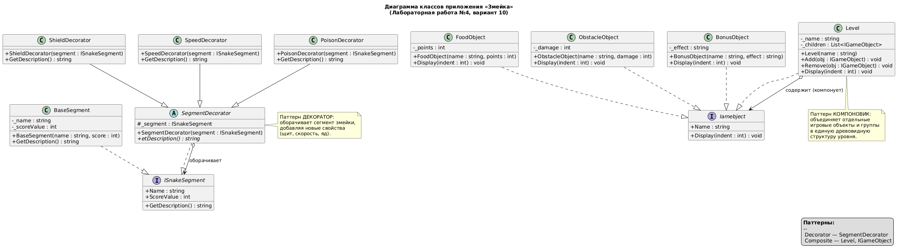
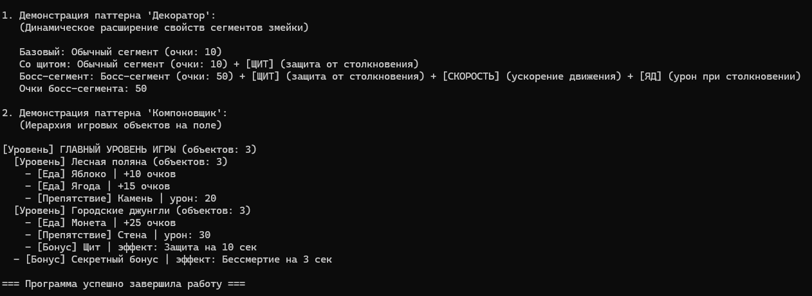

# Министерство науки и высшего образования Российской Федерации

**Федеральное государственное автономное образовательное учреждение высшего образования**  
«СЕВЕРО-КАВКАЗСКИЙ ФЕДЕРАЛЬНЫЙ УНИВЕРСИТЕТ»

**Институт информационных технологий и кибербезопасности**  
**Межинститутская базовая кафедра**

**Дисциплина:** Паттерны проектирования

## ОТЧЕТ ПО ЛАБОРАТОРНОЙ РАБОТЕ №4

**Тема:** Структурные паттерны: компоновщик, декоратор

| | |
| :--- | :--- |
| **Выполнил:** | Смакуев Ренат Арсеньевич 4 курс, группа ПИЖ-б-о-23-2(2) 09.03.04 «Программная инженерия», очная форма обучения _____________________________ (подпись) |
| **Проверил:** | ассистент МБК ИИТиКБ Белик А. И. _____________________________ (подпись) |

**Отчет защищен с оценкой:** ___________  
**Дата защиты:** __________________

**Ставрополь, 2026 г.**

---

### Цель работы
Получить практические навыки применения структурных паттернов проектирования для построения гибких иерархических объектов и динамического расширения их функциональности на языке программирования высокого уровня.

## 1. Теоретическое обоснование

В данной работе применены два структурных паттерна:
Декоратор (Decorator) – динамически добавляет объекту новые обязанности. Это гибкая альтернатива порождению подклассов для расширения функциональности. В игре «Змейка» этот паттерн применяется для оборачивания базового сегмента змейки (BaseSegment) в декораторы, добавляющие новые свойства: ShieldDecorator (сегмент со щитом — защищает от столкновения), SpeedDecorator (сегмент с ускорением — увеличивает скорость), PoisonDecorator (сегмент с ядом — наносит урон при столкновении). Это позволяет комбинировать свойства сегментов в любом порядке без создания взрывного числа подклассов.
Компоновщик (Composite) – объединяет объекты в древовидную структуру для работы с ними как с единым целым. В приложении этот паттерн реализован для построения иерархии игровых объектов на поле: FoodObject, ObstacleObject, BonusObject (листы — отдельные объекты) и Level (композиция — группа объектов уровня). Клиентский код работает одинаково как с отдельными объектами, так и с их группами.

## 2. Проектирование и реализация

**Вариант 10:** Разработка приложения «Игра «Змейка»».

**Постановка задачи:**  Расширить функционал игры для поддержки составных игровых объектов на поле и динамического расширения свойств сегментов змейки, с обязательным использованием паттернов «Компоновщик» (Composite) и «Декоратор» (Decorator) в соответствии с методическими указаниями к лабораторной работе № 4.

### 2.1. Диаграмма классов (UML)

Реализация паттернов подтверждается следующей диаграммой классов в нотации UML:

> *Рисунок 1 – Диаграмма классов*
> 

### 2.2. Исходный код

Полный исходный код также доступен в репозитории GitHub: [https://github.com/Renat-Smak/patternLabs.git](https://github.com/Renat-Smak/patternLabs.git)

> *Рисунок 2 – Результат работы программы*
> 

## Вывод

В ходе выполнения лабораторной работы № 4 было расширено приложение «Игра «Змейка»» (Вариант 10) на языке C# с применением двух структурных паттернов проектирования:
Декоратор (Decorator) позволил динамически добавлять новые свойства сегментам змейки (щит, скорость, яд) без создания взрывного числа подклассов. Благодаря этому:
можно комбинировать свойства сегментов в любом порядке (например, «босс-сегмент со щитом, скоростью и ядом»);
новые свойства добавляются простым созданием нового класса-декоратора без изменения существующего кода (соблюдение принципа Open/Closed);
декораторы можно вкладывать друг в друга, создавая сложные комбинации эффектов.
Компоновщик (Composite) обеспечил построение иерархической структуры игровых объектов на поле, где отдельные объекты (FoodObject, ObstacleObject, BonusObject) и группы объектов (Level) обрабатываются единообразно. Благодаря этому:
клиентский код работает одинаково как с отдельными объектами, так и с целыми уровнями;
можно легко строить сложные уровни («Главный уровень» → «Лесная поляна» → «Яблоко»);
автоматический подсчёт количества объектов работает рекурсивно для всей иерархии.