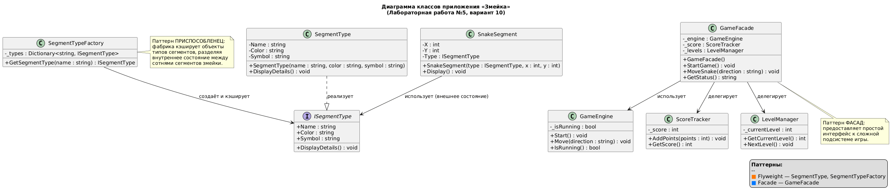
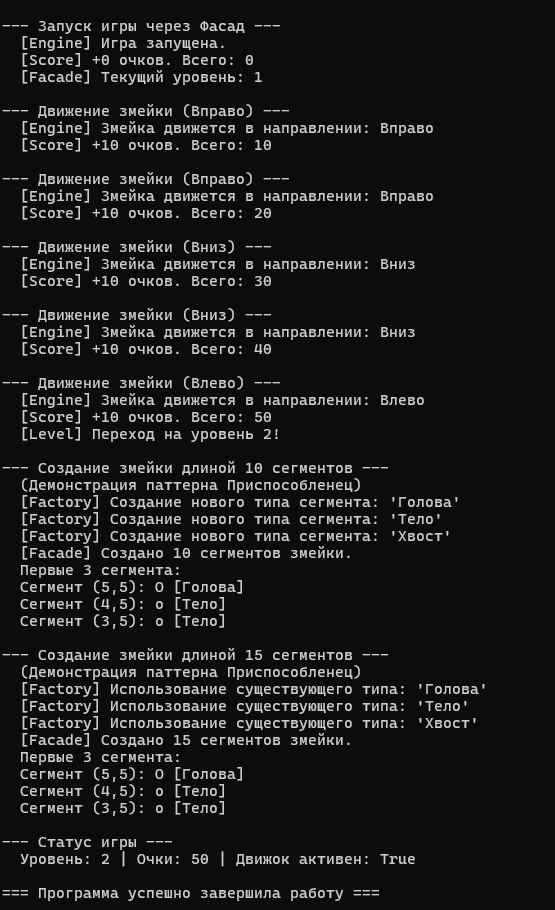

# Министерство науки и высшего образования Российской Федерации

**Федеральное государственное автономное образовательное учреждение высшего образования**  
«СЕВЕРО-КАВКАЗСКИЙ ФЕДЕРАЛЬНЫЙ УНИВЕРСИТЕТ»

**Институт информационных технологий и кибербезопасности**  
**Межинститутская базовая кафедра**

**Дисциплина:** Паттерны проектирования

## ОТЧЕТ ПО ЛАБОРАТОРНОЙ РАБОТЕ №5

**Тема:** Структурные паттерны: фасад, приспособленец

| | |
| :--- | :--- |
| **Выполнил:** | Смакуев Ренат Арсеньевич 4 курс, группа ПИЖ-б-о-23-2(2) 09.03.04 «Программная инженерия», очная форма обучения _____________________________ (подпись) |
| **Проверил:** | ассистент МБК ИИТиКБ Белик А. И. _____________________________ (подпись) |

**Отчет защищен с оценкой:** ___________  
**Дата защиты:** __________________

**Ставрополь, 2026 г.**

---

### Цель работы
Получить практические навыки применения структурных паттернов проектирования для упрощения интерфейса сложных подсистем и оптимизации использования памяти за счёт разделения состояния объектов на языке программирования высокого уровня.

## 1. Теоретическое обоснование

В данной работе применены два структурных паттерна:
Приспособленец (Flyweight) – позволяет вместить больше объектов в отведённую оперативную память за счёт разделения общего состояния между несколькими объектами. В игре «Змейка» этот паттерн применяется для типов сегментов змейки (SegmentType). Вместо того чтобы хранить название, цвет и символ отрисовки для каждого отдельного сегмента змейки (а их могут быть сотни при длинной змейке), эти данные (внутреннее состояние) выносятся в общие объекты-категории, которые создаются один раз и кэшируются в SegmentTypeFactory. Внешнее состояние (координаты X, Y) хранится в объекте SnakeSegment.
Фасад (Facade) – предоставляет унифицированный интерфейс к набору интерфейсов в подсистеме. В приложении этот паттерн реализован в классе GameFacade. Он скрывает от клиента сложную логику взаимодействия между игровым движком (GameEngine), трекером очков (ScoreTracker) и менеджером уровней (LevelManager), предоставляя простые методы StartGame(), MoveSnake(), GetStatus().

## 2. Проектирование и реализация

**Вариант 10:** Разработка приложения «Игра «Змейка»».

**Постановка задачи:**  Расширить функционал игры для эффективного хранения большого количества сегментов змейки и объектов на поле, а также упрощения клиентского API взаимодействия с подсистемами игры, с обязательным использованием паттернов «Фасад» (Facade) и «Приспособленец» (Flyweight) в соответствии с методическими указаниями к лабораторной работе

### 2.1. Диаграмма классов (UML)

Реализация паттернов подтверждается следующей диаграммой классов в нотации UML:

> *Рисунок 1 – Диаграмма классов*
> 

### 2.2. Исходный код

Полный исходный код также доступен в репозитории GitHub: [https://github.com/Renat-Smak/patternLabs.git](https://github.com/Renat-Smak/patternLabs.git)

> *Рисунок 2 – Результат работы программы*
> 

## Вывод

В ходе выполнения лабораторной работы № 5 было расширено приложение «Игра «Змейка»» (Вариант 10) на языке C# с применением двух структурных паттернов проектирования:
Приспособленец (Flyweight) позволил радикально сократить потребление памяти при хранении большого количества сегментов змейки. Благодаря фабрике SegmentTypeFactory, объекты типов сегментов (с их внутренним состоянием: названием, цветом, символом отрисовки) создаются только один раз и переиспользуются для всех сегментов. Это подтверждается выводом программы: при создании второй змейки длиной 15 сегментов объекты типов не создаются заново, а берутся из кэша ([Factory] Использование существующего типа). При длине змейки в 100 сегментов экономия памяти составила бы порядка 97 объектов вместо создания 100 новых.
Фасад (Facade) предоставил клиентскому коду простой и интуитивно понятный интерфейс (GameFacade). Клиенту больше не нужно вручную создавать движок, инициализировать трекер очков и менеджер уровней — достаточно вызвать методы StartGame(), MoveSnake() и GetStatus(), что снижает связанность кода и упрощает его поддержку.